# mcq_v2 vs multi-web — Student exam UI/UX & feature gap

**Date:** 28 Oct 2026  
**Sources:** live browser test of [Anoop2404/mcq_v2](https://github.com/Anoop2404/mcq_v2.git) at `http://127.0.0.1:8088` and multi-web local demo at `http://exam-demo.localhost:8773`  
**Focus:** student dashboard, exam pages, and features present in **mcq_v2** that are **missing or weaker** in current multi-web MCQ (portal + built-in online exam; engine noted where relevant).

Screenshots: `docs/audits/mcq_v2_comparison/screenshots/{mcq_v2,multi_web}/`

---

## Setup notes

| App | How it was run |
|-----|----------------|
| **mcq_v2** | Cloned to `/Users/neoo/laravel/mcq_v2`, MySQL `mcq_v2`, `migrate:fresh --seed`, demo student `daria1@test.com` / `password`, `php artisan serve :8088` |
| **multi-web** | `bash scripts/local-online-exam-demo.sh` on `:8773`, student `STU/DEMO/002` / `LocalExamDemo2026!` |

---

## UI side-by-side (student journey)

### 1. Login / entry

**mcq_v2** — branded Register/Login tabs, live exam promo, email *or* reg no, keycode deep-link:

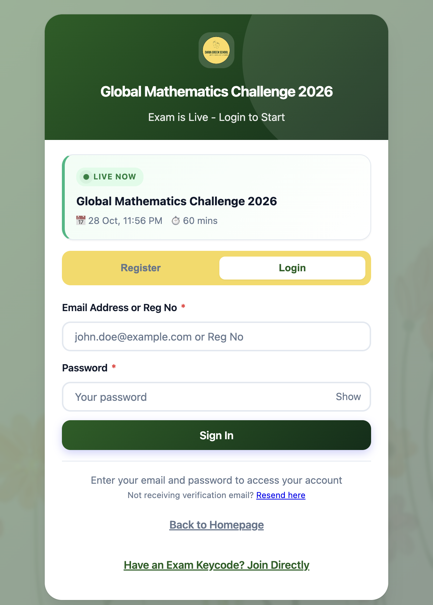

**multi-web** — Sahodaya participant portal (Student ID + password):

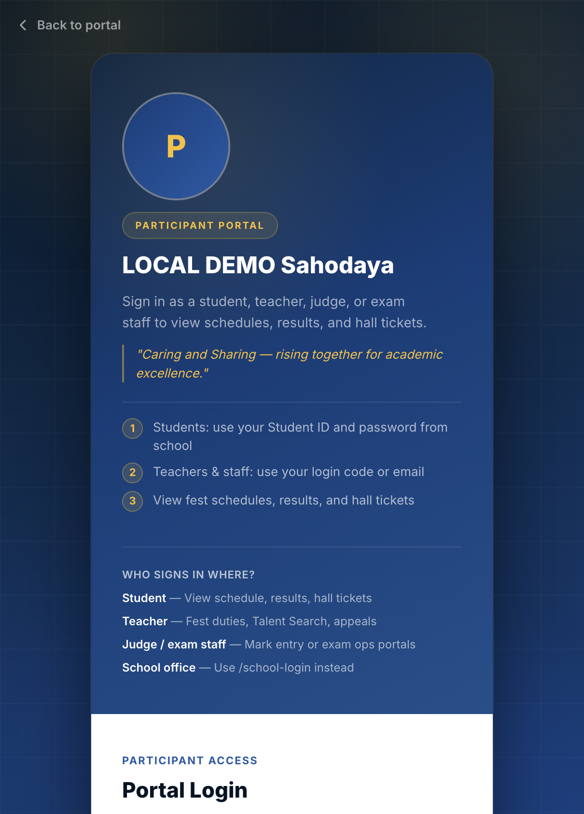

### 2. Student dashboard

**mcq_v2** — profile card, Report Center CTA, Running/Upcoming exams, mobile bottom nav:

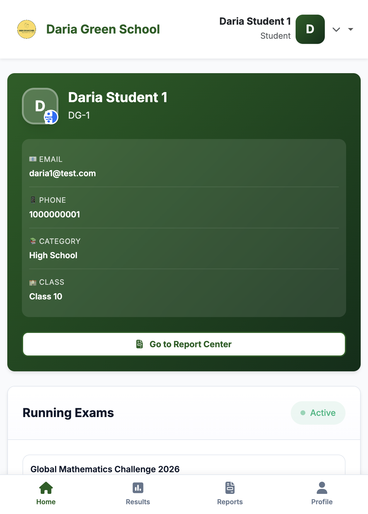

**multi-web** — portal home (fest/MCQ mix; exams via “Online exams”):

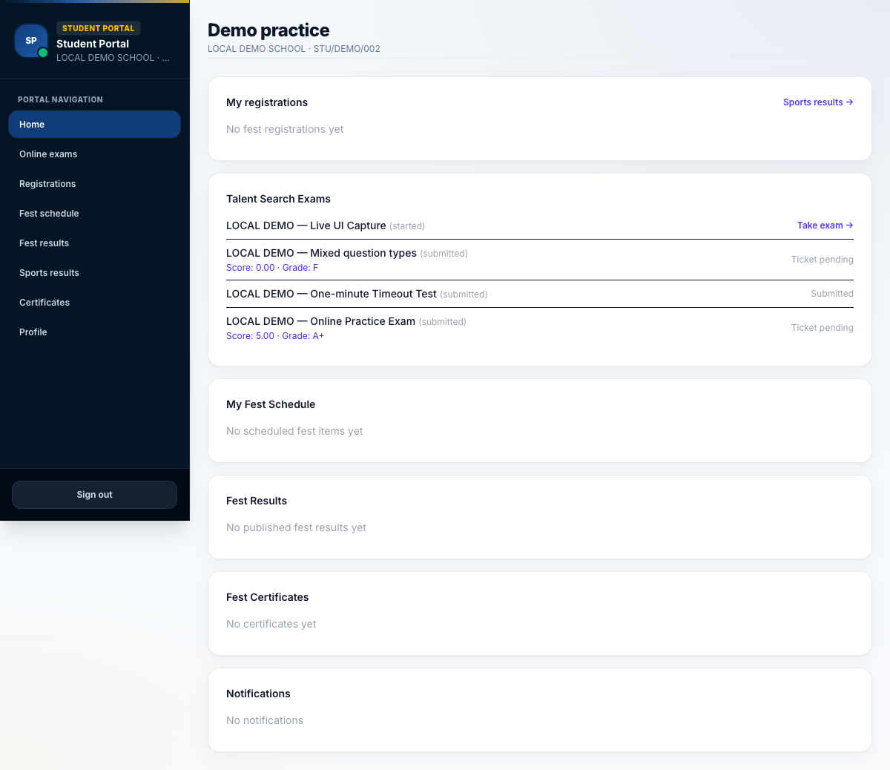

### 3. Exam list / hub

**mcq_v2 Report Center** — search by title/keycode, status filter, hall ticket / mark card / certificate columns:

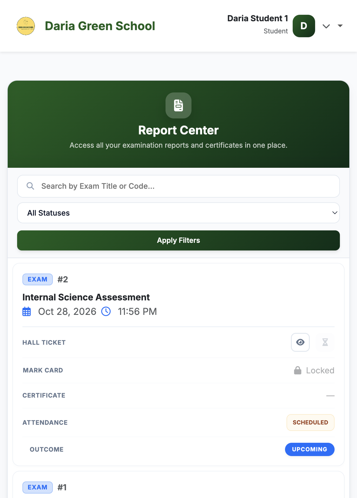

**multi-web Online exams hub** — Take exam / View result / Certificate / system-check link:

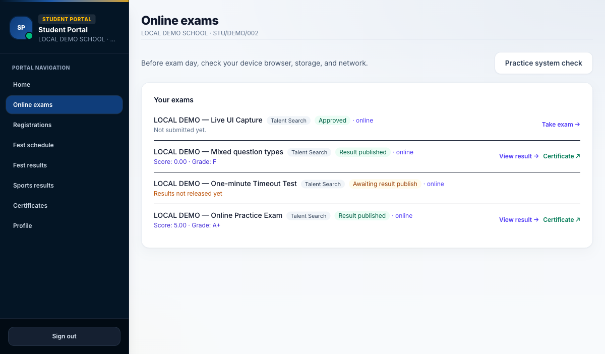

### 4. Pre-start / instructions

**mcq_v2** — identity strip, Q/marks/duration/pass cards, rules + Important Notes, accept checkbox:

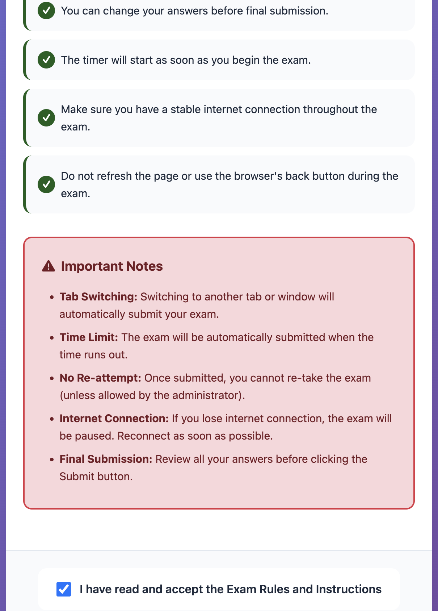

**multi-web** — “Before you start”, device quick-check, Start exam:

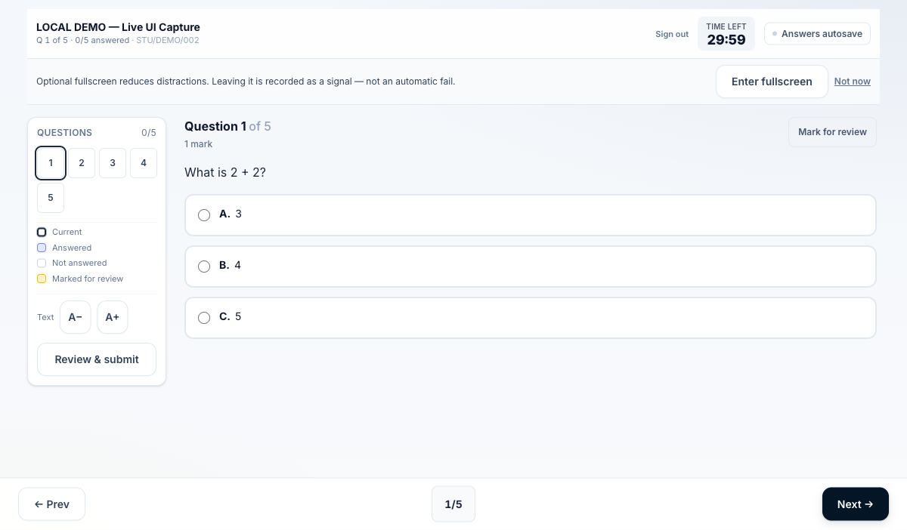

### 5. Live exam hall

**mcq_v2** — timer pill, student strip, single MCQ, option images, navigator (answered / visited / current):

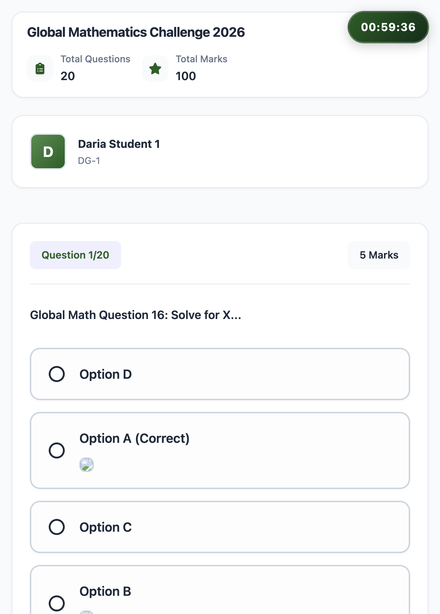

**multi-web** — timer, sync/saved pill, palette, mark-for-review, multi question types:

### 6. Distinct mcq_v2 entry: keycode attend

No multi-web equivalent for public “enter keycode → join exam”:

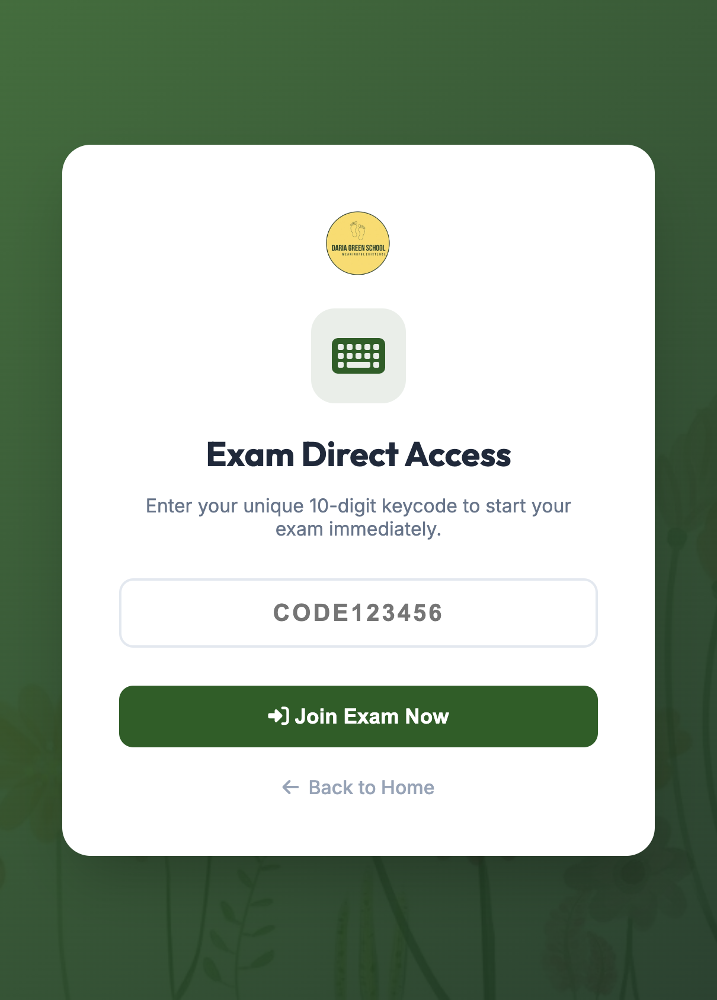

### 7. multi-web-only: practice system check

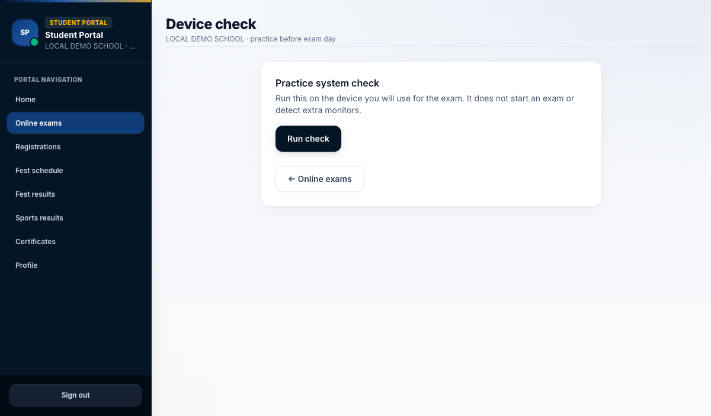

---

## Features in mcq_v2 that are **not** in current multi-web MCQ

Listed as product capabilities observed in code + UI. “Not in multi-web” means absent from student portal **and** built-in exam; engine-only equivalents are noted.

| # | Feature (mcq_v2) | What it does | multi-web today |
|---|------------------|--------------|-----------------|
| 1 | **Exam keycode direct access** (`/attend-exam`) | Public form: enter keycode → auto-login + open attempt | No public keycode join. Engine uses hall-ticket passcode / launch token after portal login |
| 2 | **Reattempt / Reattend** | `allow_reattend` + `max_attempts`; dashboard “Reattend” | One attempt lifecycle; no student reattend control |
| 3 | **Tab-switch auto-submit** | Optional `capture_tab_switches`; warnings then auto-submit (3 strikes in UI) | Proctor events **recorded** only; explicitly not auto-fail |
| 4 | **Report Center hub** | Search exams by title/keycode, filter status, download HT/mark card/cert per row | Split: Online exams hub + separate certificate/hall-ticket routes; no keycode search hub |
| 5 | **Dedicated Results history page** | Filterable completed attempts list | Results shown on hub / result page; no standalone history browser like mcq_v2 |
| 6 | **Inter-school transfer request** | Student requests transfer; cancel pending | Not part of MCQ student portal |
| 7 | **Dashboard profile photo + Cropper.js** | Upload/crop avatar from dashboard | Profile password/settings; no in-portal crop avatar for MCQ students |
| 8 | **Next-exam hero countdown** | Large “next exam” countdown on dashboard | Hub lists exams; no dedicated next-exam countdown hero |
| 9 | **Mobile bottom nav (Home / Results / Reports / Profile)** | App-like sticky footer | Sidebar / top portal nav; no MCQ bottom bar |
| 10 | **High-weightage question badge** | `weightage > 1` → “High Value” highlight | No weightage badge in portal exam UI |
| 11 | **Visited vs not-visited palette legend** | Current / answered / visited / not visited | Answered + mark-for-review (+ current); no separate “visited” state |
| 12 | **Registration priority rank / seat exclusion notices** | `registration_rank`, eligibility excluded + login flash | Cap/malpractice/withheld exist differently; no priority-rank notice UX |
| 13 | **Billing / eligibility badges on exam cards** | eligible / pending / excluded tied to school billing & caps | Approval statuses exist; no same billing-pending badge language on student cards |
| 14 | **Mark card percentile + school/national averages** | PDF mark-card enrichment | Certificates / scores / ranks; no same percentile-vs-cohort mark-card analytics on student PDF path |
| 15 | **Teacher takes same exam flow** | Shared student/teacher dashboard & exam routes | Teachers have separate portals; not a mirrored MCQ take-exam UX |
| 16 | **Accept-rules checkbox gate** | Must tick before Start on instructions | Instructions + Start; no mandatory accept checkbox |
| 17 | **SweetAlert “Start Exam?” rules modal** on Start from dashboard | Rules confirmation before navigating to instructions | Direct navigate / pre-start panel |
| 18 | **Student email verify + PIN resend UX** | Verify-pending / PIN / resend screens | Portal auth differs; not this PIN verification UX |
| 19 | **Live exam promo on login** | Login page shows LIVE NOW exam card (date, duration) | Portal login is multi-role Sahodaya branding; no live-exam promo card |
| 20 | **Mobile API extras** (`/api/v1/student/*`) | Server drafts, `exam_client_token`, FCM tokens, performance summary-by-exam | multi-web is Inertia web (+ Go engine API); no parallel Sanctum student MCQ app API like mcq_v2 |
| 21 | **localStorage answer + timer ledger (web)** | Offline continue with local answers until submit | Built-in: server autosave; Engine: IndexedDB + sync. Different model (stronger in multi-web for durability) — listed only as *behavioral difference*, not a gap to copy blindly |
| 22 | **Submission source flag** (`user` / `system`) | Distinguishes manual vs auto-submit in records | multi-web has auto-submit audits; different field naming |

---

## Features multi-web already has that mcq_v2 student UI lacks

(Useful context so gaps aren’t read as “mcq_v2 is ahead overall”.)

- Question types: **multiple**, **true/false**, **numeric** (mcq_v2 web is single-select MCQ)
- **Mark for review** (synced/persisted)
- **Server autosave** + sync/offline pill (mcq_v2 web = localStorage)
- **Practice system check** page
- **Negative marking** (supported in multi-web product model)
- Font size **A− / A+**, richer portal result review
- **Exam engine** path: Sahodaya code, check-in, waiting room, encrypted paper, watermark, device binding, start PIN, receipt, invigilator lock
- Fest / sports / certificates in the **same** student portal shell

---

## UX observations (short)

| Area | mcq_v2 | multi-web |
|------|--------|-----------|
| Visual | Green school-branded Blade, mobile-first cards | Navy Sahodaya Inertia portal, denser admin-style shell |
| Exam focus | Dedicated full-page exam module | Focus mode on exam; sidebar hidden during attempt |
| Integrity | Aggressive tab-switch messaging / optional auto-submit | Detect-only proctor + optional fullscreen |
| Documents | Report Center as one “downloads” home | Per-exam links + certificates nav |
| Ops for venues | Keycode attend for kiosk/lab | Launch URL / passcode on engine; hall ticket in portal |

---

## Suggested adoption priorities (if porting from mcq_v2)

1. **Keycode / passcode join** for venue labs (if STSE offline+online hybrid needs it).  
2. **Reattempt policy** + student Reattend CTA.  
3. **Report Center**-style document hub (search + HT/mark card/cert).  
4. Optional **harder proctor mode** (auto-submit after N tab leaves) as an exam setting — currently detect-only.  
5. **Next-exam countdown** + clearer running/upcoming split on student MCQ home.  
6. **High-value question** visual if weightage returns in papers.

---

## Artefacts

- Screenshots: `docs/audits/mcq_v2_comparison/screenshots/`
- mcq_v2 clone: `/Users/neoo/laravel/mcq_v2` (local MySQL `mcq_v2`, not committed)
- multi-web demo DB: `storage/app/local-online-demo/online-exam-demo.sqlite`
